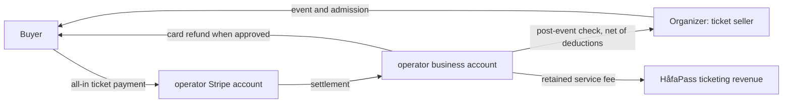

# HåfaPass counsel and CPA review packet

Prepared by engineering, 2026-10-22. **Draft for professional review, not an opinion or approval.** Please mark each position confirmed, revised, or rejected. The source links identify the section to inspect; a cited statute does not establish that HåfaPass qualifies for an exemption. Product observations were refreshed against `origin/main` at `f11e191` and this branch's policy changes. Confirm production configuration separately.

## Business model and money flow

HåfaPass is a Guam event-ticketing platform operated by Shimizu Technology LLC (the repository README's stated entity name; registration and payment-provider records still need confirmation), owned by Leon Shimizu. The event organizer sets the ticket price and refund terms, runs the event, and is intended to be the ticket seller. The Organizer Agreement appoints Shimizu Technology LLC as the organizer's **limited agent to accept buyer ticket payments**; buyer payment to HåfaPass discharges the ticket debt to the organizer. HåfaPass separately supplies ticketing services. Receipts and tickets identify the organizer as seller.

The current fee setting is **5% of a paid ticket's price plus $1.00 per paid ticket**. Free tickets have no service fee. An organizer can have the buyer pay, absorb, or split the fee. Card processing is intended to be paid by HåfaPass from the fee. The application has configurable fee and processing settings, so CPA should verify the live setting and transaction evidence. Buyer-facing prices include mandatory fees. Optional merchandise or donations and any actual government tax must appear before payment.

Buyers pay by card into the operator's Stripe account, which has a US/Nevada address. Stripe settles to its business bank account. Following the event and reconciliation, HåfaPass pays organizer proceeds by **check**, net of fees, refunds, chargebacks and adjustments. The payout flow also contains another approved payout-method path; counsel should verify whether it is enabled in production. Paid payout requires collected W-9-type tax information. Organizer proceeds and HåfaPass fees are recorded separately in the application, but cash is received into one business account. There is no verified segregated trust account.

**Current controls:** Organizer acceptance of version and content digest; buyer policy snapshot at checkout; downloadable buyer receipts; Stripe dispute intake; automatic eligible Stripe card refunds and payout holds on cancellation, with manual cash and non-Stripe door-card returns; checkout marketing consent and one-click unsubscribe; role-limited organizer sales exports with two-day private-file expiry; paid payout gated by tax record; masked TINs with audited full-TIN admin access; monthly fee and annual organizer reports. These are evidence and preparation tools. They do not determine legal classification, file returns, execute TIN matching, or prove approval. See `hafapass_api/app/services/policy_registry.rb`, `commerce/refund_creator.rb`, `event_cancellation_refunds.rb`, `event_lifecycle.rb`, `tax_reports.rb`, `payout_creator.rb`, `communication_campaigns/sender.rb`, `organizer_sales_export.rb`, `jobs/purge_marketplace_analytics_job.rb`, and `gt_translation_service.rb`.

## Questions for Guam counsel and CPA

Risk is a review priority, not a probability or legal conclusion. “Position” is our working treatment pending their decision.

| # | Issue and working position | Risk | Source and exact point | Decision requested |
|---|---|---|---|---|
| 1 | **Money transmission.** A seller appointment and discharge clause support an agent-of-payee account, but do not establish a federal or Guam exemption. Check disbursement is a particular concern. | Critical | [31 CFR 1010.100(ff)(5)(ii)(B)](https://www.ecfr.gov/current/title-31/subtitle-B/chapter-X/part-1010/subpart-A/section-1010.100); [FinCEN FIN-2013-R002, four conditions](https://www.fincen.gov/system/files/administrative_ruling/FIN-2013-R002.pdf); [FIN-2014-R009, disbursement outside regulated clearing](https://www.fincen.gov/system/files/administrative_ruling/FIN-2014-R009.pdf); [11 GCA §109102](https://col.guamcourts.gov/sites/default/files/11gc109.pdf), including US transmissions by instrument/order. | Does this exact card-to-business-account-to-check flow require FinCEN MSB registration or a Guam foreign-exchange/transmitter license? Would ACH, segregated funds, Stripe Connect, or a different structure cure it? Seek regulator/provider confirmation if appropriate. |
| 2 | **Stripe account and platform arrangement.** Guam is not listed as a supported account location; Stripe lists payment facilitation/aggregation as restricted. A Nevada address alone does not resolve the actual-business-location issue. | Critical | [Stripe territories guidance](https://support.stripe.com/questions/stripe-availability-for-outlying-territories-of-supported-countries); [global availability](https://stripe.com/global); [restricted businesses, payment facilitation](https://stripe.com/legal/restricted-businesses). | Is the account's legal entity, actual address, representative, business model and settlement flow accurate under the Stripe agreement? Obtain written approval or select an authorized structure before expansion. |
| 3 | **Guam BPT base.** Tentatively treat HåfaPass's service fee as its gross income and each organizer's ticket receipts as its own; cash passing through our account creates reclassification risk. | High | [11 GCA §§26201–26202(c),(h),(j)](https://col.guamcourts.gov/sites/default/files/11gc026_Q.pdf). The tour-agency split in §26202(j) is an analogy, not a ticketing exemption. | Will DRT accept fee-only BPT for this specific agency model? What records, contract, receipts and bank treatment support it? Are absorbed fees gross receipts? |
| 4 | **BPT rate and relief.** The Compiler's §26202(c),(h) states 4.5% from 2025-10-01 and 4% beginning **2026-10-01**. A 3% limited small-business provision in §26203.2 may apply under its conditions. Do not hard-code a rate into tax reports. | High | [11 GCA §§26202, 26203.2](https://col.guamcourts.gov/sites/default/files/11gc026_Q.pdf); the Compiler notes P.L. 38-060. | Confirm applicable category, rate, any 3% relief, monthly return, refund adjustments and first affected reporting period with DRT. |
| 5 | **1099 and W-9.** Stripe may issue a 1099-K to Shimizu Technology; it does not answer our reporting duty to organizers paid by check. Do not assume the 1099-K TPSO $20,000/200 threshold applies to us, nor default to 1099-NEC/MISC for ticket proceeds. | High | [IRS 1099-K filer/TPSO FAQ](https://www.irs.gov/newsroom/form-1099-k-faqs-should-my-organization-be-preparing-filing-and-furnishing-form-1099-k); [IRS third-party filer FAQ](https://www.irs.gov/newsroom/form-1099-k-faqs-third-party-filers-of-form-1099-k); [1099-MISC/NEC instructions, Apr. 2025, reporting hierarchy](https://www.irs.gov/pub/irs-prior/i1099mec--2025.pdf); [IRS TIN matching](https://www.irs.gov/government-entities/federal-state-local-governments/taxpayer-identification-number-tin-matching-tools). | Classify Shimizu as PSE/TPSO or other payor, identify filer/form/threshold and gross vs net amount, test W-9 substitute/e-signature, TIN matching and backup withholding. Identify where Guam information returns go. |
| 6 | **Guam business licenses.** HåfaPass activity likely needs an appropriate business license; organizer obligations depend on its activities and exemptions. A general Shimizu license may not cover ticket agency work. | High | [11 GCA Ch. 70 §§70102–70103, 70122–70123, 70130](https://col.guamcourts.gov/sites/default/files/11gc070.pdf); [Ch. 72 commercial classes](https://col.guamcourts.gov/sites/default/files/11gc072.pdf). | Which class covers HåfaPass, and what additional classes/venue permits do organizers need? Check current license and each organizer type, including charitable/political exceptions. |
| 7 | **Pricing, cancellations and consumer rights.** All-in display is the working approach. Cancelling an event starts eligible Stripe card refunds, while cash and non-Stripe door-card returns require manual action; payout holds remain until buyer refunds are resolved. | High | [16 CFR Part 464 and FTC FAQ, total-price prominence and fee purpose](https://www.ftc.gov/business-guidance/resources/rule-unfair-or-deceptive-fees-frequently-asked-questions); [5 GCA Ch. 32 §§32101, 32104 and Art. 2](https://col.guamcourts.gov/sites/default/files/5gc032.pdf). | Test real ads/event pages/checkout, fee labels, optional charges and refund notices. Set enforceable cancellation, postponement and material-change deadlines and an operations process for every outstanding order. |
| 8 | **Marketing email.** Order/ticket/event-change notices can be transactional, depending on content. Organizer campaigns now require checkout opt-in and include one-click unsubscribe; sender identity, postal address, message content and organizer training still need review. | High | [FTC CAN-SPAM guide, primary purpose and opt-out](https://www.ftc.gov/business-guidance/resources/can-spam-act-compliance-guide-business); [CAN-SPAM opt-out mechanism](https://www.ftc.gov/news-events/news/press-releases/2008/05/ftc-approves-new-rule-provision-under-can-spam-act). | Review sender postal address, consent/legal basis and organizer training. Decide who is the legal sender. |
| 9 | **Privacy and breach.** HåfaPass is responsible for its platform processing; organizers independently use attendee data. Guam's notice rule has defined triggers and “without unreasonable delay,” not a fixed general deadline. | High | [9 GCA Ch. 48 §§48.20, 48.30](https://col.guamcourts.gov/sites/default/files/9gc048.pdf). | Approve incident runbook, vendor agreements, organizer data terms, cross-border access, TIN/key compromise response, and notice ownership. Confirm other applicable US state/territory laws. |
| 10 | **Payout exposure, card disputes and accounting.** Post-event checks reduce advance risk but do not eliminate refunds, chargebacks or organizer insolvency. Stripe says the disputed amount and fee are debited while an issuer decides; an open dispute cannot be separately refunded through the ordinary flow, and response windows are limited. Net revenue presentation is plausible only if ASC 606 control analysis supports it. | High | [FASB ASU 2016-08, ASC 606 principal-agent control](https://storage.fasb.org/ASU%202016-08.pdf); [Stripe dispute process and timing](https://support.stripe.com/embedded-connect/questions/how-disputes-work); [Mastercard chargeback guide](https://www.mastercard.com/content/dam/mccom/shared/business/support/rules-pdfs/chargeback-guide.pdf). | Approve reserve/holdback formula, maximum negative balance, evidence owner/deadlines, collection rights, insurance, cash segregation, liabilities and recognition timing. |
| 11 | **Ticket resale and bots.** The product supports free transfer, not platform resale. No general Guam resale statute was found in this bounded search, but event-specific rules exist: Guam boxing/wrestling rules restrict promoter ticket pricing. Federal BOTS Act is enacted. TICKET Act H.R. 1402/S. 281 still appears in the October 13, 2026 House calendar; BOSS/SWIFT proposals should not be treated as enacted law. | Medium | [3 GAR Ch. 4 §4610, unarmed-combat tickets](https://guamcourts.gov/CompilerofLaws/GAR/03GAR/03GAR004.pdf); [FTC BOTS Act guide](https://www.ftc.gov/business-guidance/blog/2025/04/bots-act-compliance-time-refresher); [introduced H.R. 1402 TICKET text](https://www.congress.gov/119/bills/hr1402/BILLS-119hr1402ih.pdf); [House calendar, October 13, 2026](https://www.govinfo.gov/content/pkg/CCAL-119hcal-2026-10-13/html/CCAL-119hcal-2026-10-13-pt20.htm). | Check Guam resale rules by event type and any price caps; verify current federal bill status before reliance. Congress.gov's current status page was inaccessible here. |
| 12 | **Admissions and other event taxes.** The old general admission tax is repealed; that does not exempt every organizer from BPT or facility-specific tax. Older Guam tax regulations still describe admissions-ticket tax and should not be used without reconciling the repeal. | Medium | [11 GCA Ch. 22 Art. 3 repealed; Art. 4 §22401 recreation facilities](https://col.guamcourts.gov/sites/default/files/11gc022.pdf); [older 30 GAR Ch. 2 admission-ticket provisions](https://col.guamcourts.gov/sites/default/files/30GAR001-2.pdf); [Ch. 26 BPT](https://col.guamcourts.gov/sites/default/files/11gc026_Q.pdf). | Confirm whether any event, facility, alcohol, gambling, hotel or municipal tax/fee applies; identify collector and checkout presentation. |
| 13 | **Accessibility and minors.** Aim for WCAG 2.1 AA; do not claim conformance before testing. General-audience COPPA position depends on actual marketing and knowing collection from under-13 users. | Medium | [DOJ ADA web guidance, Title III](https://www.ada.gov/resources/web-guidance/); [FTC COPPA FAQ](https://www.ftc.gov/business-guidance/resources/complying-coppa-frequently-asked-questions). | Review site and event accommodation duties, assisted checkout process, age statement and minor attendee data. |
| 14 | **International visitors.** Nationality alone does not decide privacy jurisdiction. Japanese APPI §171 focuses on services to people **in Japan**; Korean PIPC lists service targeting, significant impact and Korean establishment; GDPR Art. 3 looks to EU establishment or targeting/monitoring people in the EU. Guam checkout for tourists may be lower exposure, but Korean/Japanese language availability, campaigns and remote buying increase it. | Medium | [Japan PPC APPI guideline §8/Art. 171](https://www.ppc.go.jp/personalinfo/legal/guidelines_tsusoku/); [Korea PIPC foreign-operator guidance](https://pipc.go.kr/eng/user/ltn/new/noticeDetail.do?bbsId=BBSMSTR_000000000001&nttId=2488); [EDPB Guidelines 3/2018, Art. 3](https://www.edpb.europa.eu/sites/default/files/files/file1/edpb_guidelines_3_2018_territorial_scope_after_public_consultation_en_0.pdf). | Determine whether HåfaPass targets or serves people while in Japan, Korea or the EU; decide language, rights, cross-border transfer and child rules. Korea's guidance mentions parental consent under 14. |
| 15 | **Organizer contract protections.** Draft adds content license, indemnity, venue/permit/alcohol/insurance duties, force majeure, Guam venue, resale/bot limits, holds and survival. No arbitration clause is proposed. | Medium | Compare [Eventbrite organizer refunds](https://www.eventbrite.com/help/en-us/articles/827759/eventbrites-organizer-refund-policy-requirements/), [Ticketmaster purchase policy](https://help.ticketmaster.com/hc/en-us/articles/10465798887953-Purchase-Policy), [Universe terms §§5,7,10](https://www.universe.com/terms), [Ticket Tailor terms](https://www.tickettailor.com/legal/terms-and-conditions). | Edit liability cap and nonwaivable-rights carve-outs, venue, indemnity procedure, proof of insurance and account termination language. |

### Comparable platform check

Eventbrite makes organizer refund rules subject to minimum requirements and reserves intervention; HåfaPass's draft now says who initiates refunds and keeps organizer funding responsibility. Ticketmaster states event-change remedies are informed by organizer authority; HåfaPass still needs an operator process for manual cash and non-Stripe card returns and failed or disputed refunds. Universe expressly addresses listings, holdbacks and cancellation; HåfaPass now addresses those topics but should avoid importing Universe's nonrefundable service-fee approach. Ticket Tailor places buyer refund terms with organizers; HåfaPass retains a stronger platform cancellation promise because it controls the payment account. [GuamTime's services page](https://www.guamtime.net/services) says it pays by post-event check, but a complete public terms text was not located; do not treat it as a legal precedent.

## CPA workpaper and accounting decisions

1. **BPT:** Reconcile monthly ticket collections, fee allocations (buyer-paid and organizer-absorbed), refunded fee allocations, processor costs, and non-ticket items. The existing admin report is a gross-fee workpaper, not a filed BPT return. Determine whether Shimizu reports only its fee or any ticket gross, the applicable §26202 class/rate, §26203.2 small-business relief, refund period treatment and whether organizers report gross ticket receipts before fees. Keep the agent agreement, seller-marked receipt and item ledger with each period.
2. **Income tax and information returns:** [IRS Publication 570, Guam section](https://www.irs.gov/publications/p570) describes Guam's mirror income-tax system and DRT filing for bona fide residents. Do not assume it answers entity-level tax or information-return routing. Reconcile Stripe's 1099-K to the Shimizu ledger and organizer receipts to actual checks. Determine 1099-K payer status vs 1099-MISC/NEC treatment, including entity exemptions and duplicate-reporting rules. Collect signed payee data before checks; approve TIN matching, mismatch notices and backup withholding procedure. The application currently validates/masks TINs but does not match with IRS or file returns.
3. **Revenue recognition:** Under ASC 606, identify each specified promise (event admission vs platform ticketing), who controls each before transfer, pricing discretion, fulfillment responsibility and refund/inventory risk. Document whether ticket gross is a payable to organizers and fee is Shimizu revenue, or whether facts force gross treatment. Record Stripe processing cost as Shimizu expense when it absorbs it; separately track refunds, dispute losses, reserves, bad debts and the timing of fee recognition. BPT and financial-statement conclusions may differ.
4. **Records:** Approve a retention matrix for W-9/e-sign evidence, payout checks, bank/Stripe statements, buyer orders, settlement and refund/dispute evidence, audit logs and tax returns. Seven years is a proposal, not an implemented purge. Confirm access controls, legal holds and disposal. An analytics purge runs after 13 months only for marketplace events not tied to an order.
5. **Other taxes:** 11 GCA Ch. 22 Art. 3 admissions tax is repealed; recreation-facility and activity-specific rules still need review. Ask DRT whether any sales-tax-like charge applies to the ticket or add-ons, which party owes it, and whether it is included or shown separately under the FTC rule.

The FTC's [Part 464 FAQ](https://www.ftc.gov/business-guidance/resources/rule-unfair-or-deceptive-fees-frequently-asked-questions) also asks sellers to explain the nature and purpose of fees. Counsel should review whether the checkout's short “service fee” label, together with the Buyer Terms explanation, is clear enough in every language and channel. A government tax may be excluded from the advertised total only if its nature and amount are disclosed before payment under the rule's conditions.

## Product gaps and follow-up owners

| Priority | Gap and observed behavior | Proposed follow-up |
|---|---|---|
| P0 | Organizer campaigns now require checkout opt-in and include one-click unsubscribe, but sender address, content classification and operating rules still need review. | Counsel and operations should approve the campaign purpose rule, sender details and organizer training before promotional use. |
| P0 | Event cancellation starts eligible Stripe card refunds and holds payouts; cash, non-Stripe door-card, disputed and failed refunds still require an operator. | Assign an owner to reconcile the cancellation run, complete manual returns and clear exceptions before releasing held payouts. |
| P1 | No automated seven-year financial/TIN retention or legal hold schedule. Only marketplace analytics and short-lived runtime data have purge jobs. | Approve schedule, implement record-class deletion/hold and vendor deletion before promising a purge date. |
| P1 | W-9 collection is not TIN matching or return filing; no backup-withholding workflow identified. | CPA decides form/filer and a controlled preparation/filing process; engineering adds only the approved controls. |
| P1 | Check payout may defeat the federal processor exemption; no verified segregated account or Stripe authorization for third-party proceeds. | Counsel and Stripe determine structure before scale. |
| P2 | Current public policy pages are English; Korean/Japanese frontend and automatic organizer-content translation are present or optional. | Translate approved policies if counsel concludes needed; review General Translation data transfer and terms. |
| P2 | No independent WCAG conformance audit; offline scanner data is on organizer devices. | Run focused accessibility QA and agree scanner-device retention/revocation protocol. |

## Decisions to sign off

- [ ] Agent-of-payee and money transmission under federal and Guam law; payment rail, fund custody and Stripe approval.
- [ ] BPT base, class, 4% general rate and any small-business relief; organizer tax allocation.
- [ ] 1099 filer/form/threshold, Guam/IRS filing location, W-9 substitute, TIN matching and backup withholding.
- [ ] Cancellation/postponement/material-change refund remedy, deadline and operational owner; chargeback allocation and reserve.
- [ ] Business license class for Shimizu and organizer permit/insurance requirements.
- [ ] Organizer and HåfaPass attendee-data roles, marketing-email permissions, breach procedures and vendor agreements.
- [ ] International-visitor privacy scope, policy languages, child age rules and accessibility target.
- [ ] Contract liability caps, indemnity, Guam venue, force majeure and version acceptance.
- [ ] Record retention, legal holds and principal/agent accounting memo.

## Live draft policy pages

All pages should show a draft-review notice until professional approval: [Buyer Terms](https://hafapass.shimizu-technology.com/policies/buyer-terms) · [Refund & Cancellation](https://hafapass.shimizu-technology.com/policies/refunds) · [Privacy](https://hafapass.shimizu-technology.com/policies/privacy) · [Organizer Agreement](https://hafapass.shimizu-technology.com/policies/organizer-agreement) · [Acceptable Use](https://hafapass.shimizu-technology.com/policies/acceptable-use) · [Data Retention](https://hafapass.shimizu-technology.com/policies/retention) · [Cookie Notice](https://hafapass.shimizu-technology.com/policies/cookies) · [Accessibility](https://hafapass.shimizu-technology.com/policies/accessibility).

The branch draft is **not live until integrated and deployed**. Any policy text/version change alters `PolicyRegistry` digests. Organizers must re-accept; the admin policy register requires a new approval of the exact snapshot. Buyer checkout records the new version/digest. Approval of draft text is an explicit operational acknowledgment, not legal signoff.

## October 22 policy findings and primary sources

This is engineering's practical review of version `2026-10-counsel-draft-3`, not legal advice. Risk reflects priority for professional or operational review. The code references are from `f11e191` plus this branch; production settings and provider agreements require separate verification.

| Risk | Issue and evidence | Fix or disposition |
|---|---|---|
| High | The agreement said fee changes applied only to newly published events, while `SiteSetting` holds a shared fee and `Commerce::ServiceFee` quotes it for new orders. The [FTC Part 464 guide](https://www.ftc.gov/business-guidance/resources/rule-unfair-or-deceptive-fees-frequently-asked-questions) requires the total including mandatory fees to be the prominent upfront price, with excluded tax or optional charges and the final amount disclosed before payment. | Removed the unsupported event-publication promise. `Marketplace::EventSerializer`, `Commerce::ServiceFee`, `OrderCreator`, event pages and checkout use the all-in quote, but live settings, ads, optional items, tax and responsive checkout still need an operational walkthrough. |
| High | The public privacy and retention text presented seven years as a minimum and implied complete deletion after a request. `PurgeMarketplaceAnalyticsJob` removes only unlinked analytics after 13 months; no financial-record purge or general deletion workflow was found. [Guam breach law, 9 GCA Ch. 48](https://col.guamcourts.gov/sites/default/files/9gc048.pdf) also uses specific notice triggers, not notice for every incident. | Public text states the present retention limit and describes breach assessment before legally required notice. Counsel and CPA must set the schedule, request process and incident runbook. |
| High | The cancellation promise and absolute exclusion for used, transferred or disputed tickets could conflict. `EventCancellationRefunds` and `EventCancellationRefundJob` start eligible Stripe refunds and hold payouts; cash, non-Stripe card, open disputes and failures need manual work. [5 GCA Ch. 32 §32104](https://col.guamcourts.gov/sites/default/files/5gc032.pdf) limits waivers of consumer protections; [Stripe payment terms §5.2](https://stripe.com/legal/ssa-service-terms) make the account holder liable for refunds and disputes and permit delayed or refused refunds. | Clarified that the ordinary refund exclusions do not remove the stated cancellation remedy or nonwaivable rights. An operator still needs to reconcile every unresolved payment. |
| Medium | `PolicyRegistry` sent readers without a configured support address to order recovery, which cannot accept privacy or accessibility requests. The support-email migration uses `shimizutechnology@gmail.com`; the README identifies Shimizu Technology LLC, while `SellerIdentity` used the shorter brand. [FTC CAN-SPAM guidance](https://www.ftc.gov/business-guidance/resources/can-spam-act-compliance-guide-business) requires accurate sender identity, a valid postal address and opt-out for commercial mail. | Policy contact fallback now names the migration's mailbox, and receipts/policies use the LLC name. Confirm the registered entity, monitored mailbox, configured `MAILER_FROM_EMAIL`/reply-to, and business mailing address before approval. |
| Medium | The buyer and organizer venue clause was generic. [7 GCA §3105](https://col.guamcourts.gov/sites/default/files/7gc003.pdf) gives the Superior Court of Guam original jurisdiction, while [5 GCA §32104](https://col.guamcourts.gov/sites/default/files/5gc032.pdf) protects nonwaivable buyer rights. | Named Superior Court of Guam with jurisdiction and mandatory-law qualifications; counsel must decide enforceability, especially for off-island buyers. |
| Medium | Organizer campaigns use checkout opt-in, a mailing-address send gate, unsubscribe headers and send-time suppression (`CommunicationCampaigns::Sender`, `MessageDeliveryJob`, `EmailService`). [FTC CAN-SPAM guidance](https://www.ftc.gov/business-guidance/resources/can-spam-act-compliance-guide-business) distinguishes transaction notices by primary purpose, not label. | Current policy distinguishes marketing and service messages. Review actual templates and sender details; do not turn event-change mail into promotion. |
| Medium | [FTC COPPA guidance](https://www.ftc.gov/business-guidance/resources/complying-coppa-frequently-asked-questions) makes child-directed services and actual knowledge relevant; a terms age line alone does not decide coverage. [DOJ ADA web guidance](https://www.ada.gov/resources/web-guidance/) calls for accessible online services. | Kept the under-13/parent purchase explanation and removed an untracked accessibility response deadline. Test assisted buying, seat maps, PDFs and event accommodations. |
| Low | `LaunchCapabilities` has recurring **events**, but no recurring buyer billing flow was found. [ROSCA, 15 U.S.C. §8403](https://www.govinfo.gov/content/pkg/USCODE-2024-title15/pdf/USCODE-2024-title15-chap110-sec8403.pdf) applies to online negative-option billing. | No subscription clause added. Recheck ROSCA before introducing memberships or auto-renewal. |
| Low | [FTC BOTS guidance](https://www.ftc.gov/business-guidance/blog/2025/04/bots-act-compliance-time-refresher) addresses circumvention at public events over 200 capacity. [GovInfo's October 13, 2026 House calendar](https://www.govinfo.gov/content/pkg/CCAL-119hcal-2026-10-13/html/CCAL-119hcal-2026-10-13-pt22.htm) still lists the TICKET Act proposal; the search found no enacted BOSS/SWIFT ticket law. [Guam's repealed admissions tax](https://col.guamcourts.gov/sites/default/files/11gc022.pdf) does not decide BPT or event-specific levies. | Keep the transfer/anti-bot limits and no resale-marketplace claim. Counsel should check Guam event-specific ticket rules and future federal changes. |

The [Compiler's BPT chapter, 11 GCA §§26201–26203.2](https://col.guamcourts.gov/sites/default/files/11gc026_Q.pdf) shows the general rate step down to 4% on October 1, 2026, but the taxable base, class, small-business relief, and whether ticket gross belongs to the organizer remain CPA/DRT questions. The service fee is not described as a government tax in the policies. The [IRS 1099-K filer guidance](https://www.irs.gov/newsroom/form-1099-k-faqs-should-my-organization-be-preparing-filing-and-furnishing-form-1099-k) and [TIN matching guidance](https://www.irs.gov/government-entities/federal-state-local-governments/taxpayer-identification-number-tin-matching-tools) do not turn the app's W-9 collection into filing, matching or backup withholding.

### Questions for counsel and CPA before Leon approves this register

1. Is **Shimizu Technology LLC** the exact registered contracting and Stripe merchant entity, and is the configured support mailbox monitored? What postal address should appear on commercial mail?
2. Is the agent-of-payee, Stripe-account-to-business-bank-to-check structure lawful and provider-approved? Which refunds, chargebacks, reserves and bank custody terms need revision?
3. What cancellation, postponement and material-change remedies and request deadlines can the buyer be promised? Who owns manual and failed refunds, and when may a held payout be released?
4. Is Superior Court of Guam venue enforceable for organizers and visiting buyers with the stated mandatory-law carve-out? Are the liability caps, indemnity and no-arbitration approach suitable?
5. What BPT class, base and rate apply to the platform and each organizer? Which entity files each W-9-based information return, and what TIN matching, withholding and retention steps are required?
6. What incident notice, deletion, legal hold, organizer data-sharing and international transfer duties apply? Does the current General Translation vendor and cookie inventory require further consent or terms?
7. Which Guam event licenses, ticket-resale limits, venue accessibility duties and child-audience controls apply to the events this platform will actually host?
