# Copa de Marianas 2027 — Volunteer Door Kit

**Saturday, January 30, 2027 · UOG Calvo Field House (Mangilao)**  
**Spectator tickets:** Child **$12** · Adult **$17** · **Under 5 free** *(Child / Under 5 age: ask the Door lead, don't guess.)*

> **Notice:** **Screens from the Nov 24 builds — refresh before printing.** *(See [Screenshot Sources](#screenshot-sources-and-deeper-runbooks) for which build each screen comes from.)*  
> **Demo data · all names fictional.** Screenshots come from fictional preview events (*Isla Demo Open 2027 (demo)*, *Tumon Bay Acoustic Sessions (demo)*, and *FD Alumni Basketball (demo)*). Prices, counts, emails, and attendee names shown on screen are not real.

## Jump to your role

- [Escalation Contacts](#escalation-contacts)
- [Pre-Doors Checklist](#pre-doors-checklist)
- [Role 1: Door Scanner (Phone Guide)](#role-1-door-scanner)
- [Re-entry or Hand-Stamp Rule — Choose One Before Event Day](#re-entry-or-hand-stamp-rule-choose-one-before-event-day)
- [Role 2: Box Office (Cash & Card Sales)](#role-2-box-office)
- [Refreshing the Saved Ticket List](#refreshing-the-saved-ticket-list)
- [Backup Attendee List & Paper Fallback](#backup-attendee-list-and-paper-fallback)
- [End-of-Night Checklist](#end-of-night-checklist)
- [Print-Friendly One-Sheet Role Cards](#print-friendly-role-cards)
- [Screenshot Sources & Deeper Runbooks](#screenshot-sources-and-deeper-runbooks)

---

## Escalation Contacts

Fill in before doors open. Keep attendee details off public chats.

| Role | Name & Phone | When to call |
| --- | --- | --- |
| **Door lead** | `[Door lead name / phone]` | Duplicate scans, re-entry overrides, age questions, refunds/transfers, cash questions, paper fallback |
| **Backup lead** | `[Backup door lead / phone]` | When the Door lead is busy at another gate |
| **HåfaPass on-call** | `[HåfaPass on-call]` | App outage, sync stuck, expired ticket list, card payment stuck waiting for confirmation |
| **Venue contact** | `[Venue contact]` | UOG Calvo Field House doors, power, Wi-Fi, crowd flow, parking |
| **Medical / Security** | `[Medical]` | Any injury, fainting, heat, or safety incident (call 911 first for emergencies) |

---

## Pre-Doors Checklist

*Takes about 10 minutes. Finish **15–30 minutes before doors open**.*

- [ ] **Charge your phone:** 100% charged with a battery pack or cable ready.
- [ ] **Turn up screen and sound:** High brightness and volume up so you hear scan beeps.
- [ ] **Keep the screen awake:** Set iPhone **Auto-Lock** or Android **Screen timeout** to **Never** for your shift.
- [ ] **Sign in on your own phone:** Open your staff invite link in Safari (iPhone) or Chrome (Android). Never share one login between volunteers.
- [ ] **Check your scanner:** Open **Scanner** (the screen title says **Check-in**), choose **Copa de Marianas**, and check that you see **Online**, **Waiting to sync: 0**, and **Ticket list ready · N tickets** with a future Guam expiry time.
- [ ] **Download the latest list:** Tap **Sync now** once while online (15–30 minutes before doors open).
- [ ] **Run one test scan:** Tap **Start camera**, allow camera permission, scan one test QR, and try typing a code under **Enter a ticket QR code**.
- [ ] **Confirm today's re-entry rule:** Make sure everyone knows whether today is **Option A (Exit scan)** or **Option B (Hand stamp)**.
- [ ] **Check the box office:** Count the starting cash float with the Door lead, check small bills, confirm whether pay-by-card options are turned on, and check printer paper/battery if printing tickets.
- [ ] **Check the Manager Desk backup:** Confirm the backup attendee CSV (on the organizer's laptop) and printed door list plus numbered exception log are ready and kept private.

---

## Role 1: Door Scanner

### Step 1: Open Check-in and start the camera

1. Sign into HåfaPass in Safari or Chrome using **your own** staff invite.
2. Open **Scanner** from the menu. *(The page title says **Check-in**.)*
3. Under **Event to scan**, pick **Copa de Marianas**.
4. Confirm you see **Online**, **Waiting to sync: 0**, and **Ticket list ready · N tickets**.
5. Tap **Start camera** and allow camera access.
6. Leave **Sound** turned on.

  
*Ready to scan on the Check-in screen (single-entry mode). Demo data · all names fictional.*

### Step 2: Scan a ticket and read the color

Point the camera at the guest's QR code (phone screen, screenshot, or printed ticket). The whole screen flashes with the result:

| Color | What it means | What you do |
| --- | --- | --- |
| **Green — Admitted** | Valid ticket. Clears in about 1 second. | Welcome **one person** in. Stamp their wrist/hand now *(Option B only)*. |
| **Blue — Exited** | Guest scanned out *(Option A only)*. Clears in about 1 second. | Let them step out. They can scan back in later. |
| **Amber — Check ticket** | Already scanned, already inside, or waiting to re-enter. Stays until tapped. | **Do not wave them in.** Tap to dismiss, read the reason under the camera, and send them to the **Door lead**. |
| **Red — Do not admit** | Wrong event/day, QR not found, cancelled, refunded, or re-entry limit reached. Stays until tapped. | **Do not admit.** Tap to dismiss, read the reason, try **Find an attendee**, or send them to the **Door lead**. |

#### Green: Admitted

  
*Valid admission. Demo data · all names fictional.*

#### Amber: Already used (single-entry mode)

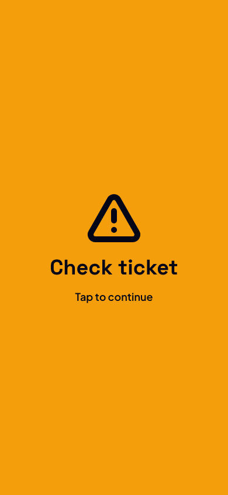  
*Already scanned in single-entry mode. Tap to dismiss, read the reason under the camera, and send the guest to the Door lead. Demo data · all names fictional.*

#### Red: Wrong event / day, not found, or cancelled

  
*QR not in this event's ticket list, wrong day/event, or cancelled/refunded. Tap to dismiss and try **Find an attendee** or ask the Door lead. Demo data · all names fictional.*

#### Offline mode (weak gym signal)

If Wi-Fi or cell service drops, keep scanning. Your phone checks the saved ticket list and holds each scan in **Waiting to sync** until signal returns.

  
*Offline mode with 1 scan saved on the phone. Do **not** sign out or clear browser data; tap **Sync now** once Online returns. Demo data · all names fictional.*

#### Guest has no working QR? Use Find an attendee

1. Tap **Find attendee** (or scroll down to **Find an attendee**).
2. Type the guest's name or ticket number (`HP-T...`).
3. Tap **Search**. *(Email addresses stay hidden for privacy.)*
4. Match the name and ticket type, then tap **Admit**.

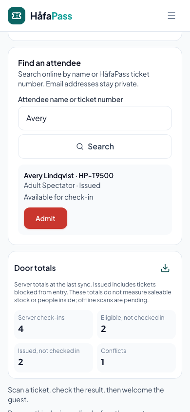  
*Online attendee search by name or ticket number. Demo data · all names fictional.*

---

### Step 3: Re-entry scanning (only if Option A — Exit scan — is turned on)

#### Using the ENTRY / EXIT switch

When Exit scan is on, you see big **ENTRY** and **EXIT** buttons plus the live **Inside now** count:

1. **Incoming lanes:** Keep green **ENTRY** selected.
2. **Exit lane:** Tap blue **EXIT** before scanning guests who are stepping out.

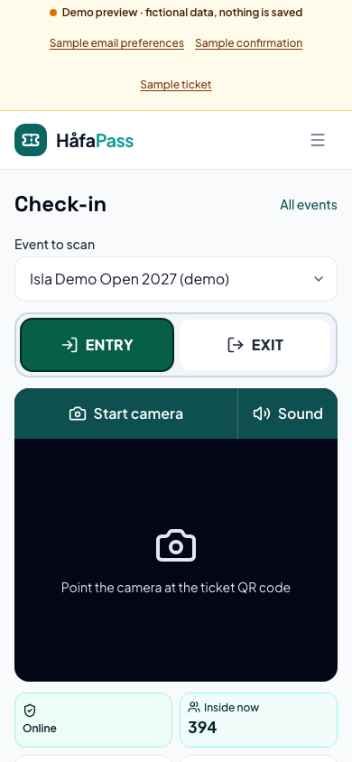  
*Exit-scan mode with **ENTRY / EXIT** switch and live **Inside now** count. Demo data · all names fictional.*

- **Already inside (blocks shared screenshots):** If someone scans a ticket at **ENTRY** that is still marked inside, the phone flashes amber **Already inside** with the time and gate of the earlier scan. Have them scan out at the Exit lane first, or send them to the **Door lead**.

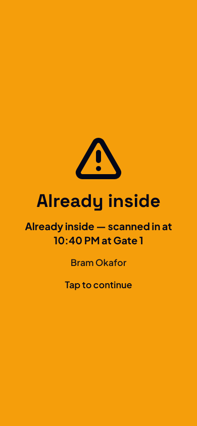  
*Warning when an already-inside ticket is scanned at ENTRY. Demo data · all names fictional.*

- **Scanning a guest out:** Switch to **EXIT** and scan their QR. A blue **Exited** flash confirms they are checked out and lowers **Inside now** by 1. *(Scanning a ticket that isn't inside shows **Not inside**.)*

  
*Confirmed exit scan. Demo data · all names fictional.*

- **If the organizer uses Cool-down instead of Exit scan:** There is no Exit switch. Re-scanning too soon shows amber **Wait to re-enter** with the minutes left.

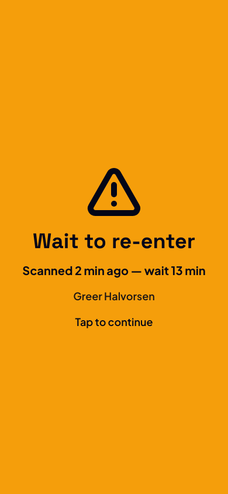  
*Wait warning when Cool-down mode is active. Demo data · all names fictional.*

#### Re-entry limit reached & Door lead override

**Override rule (one rule for every gate):** **Only the Door lead (signed in with a lead role) can override. Volunteers never override.**

- If you see **Re-entry limit reached**, **Already inside**, or **Re-entry closed**, send the guest to the **Door lead**.
- **Never override on a guest's word alone.** The Door lead checks the ticket/guest first, then types what they actually verified in the **Reason for override** box (saved permanently in the event log).
- Overrides require an **Online** connection.

1. Tap to dismiss the red or amber overlay.
2. Under the camera, tap **Lead override**.
3. Pick **Admit (re-entry)** or **Clear inside status**.
4. Type what you checked in **Reason for override** (required).
5. Tap **Confirm override & Admit** (or **Confirm override & Clear**).

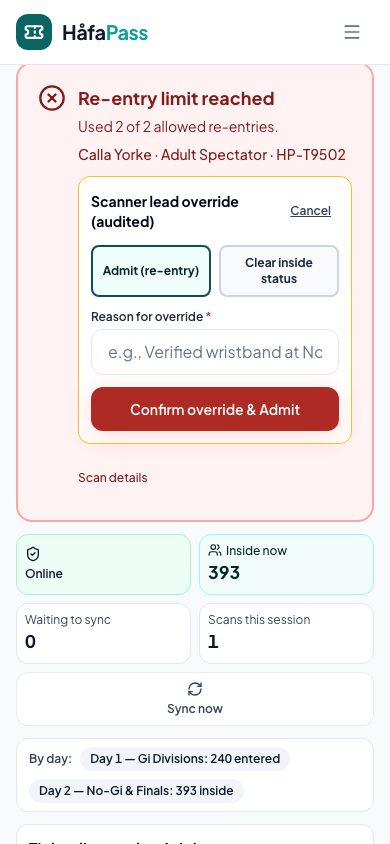  
*Re-entry limit reached with the Door lead override form open. Note: the grey placeholder inside the box ("e.g., Verified wristband…") is only a sample format — record what you actually checked, and do not quote it to guests. Demo data · all names fictional.*

*(Organizer note: In HåfaPass, the **Lead override** button appears only when online, re-entry is on, and the signed-in account has Owner, Manager, Box office, or event-assigned Scanner lead permissions.)*

---

## Re-entry or Hand-Stamp Rule — CHOOSE ONE BEFORE EVENT DAY

> ### **Choose one before event day — do not mix**
> The organizer chooses **Option A** or **Option B** before doors open and briefs every gate volunteer.
>
> #### **Option A — Exit scan in HåfaPass**
> - **Event setting:** Re-entry policy set to **Exit scan (in & out)**.
> - **Staff needed:** Entry scanner(s) + a staffed Exit scanner at the exit door.
> - **First arrival:** Scan QR on **ENTRY** → green **Admitted**. No ink stamp needed.
> - **Leaving:** Guest scans QR on **EXIT** → blue **Exited**.
> - **Coming back:** Guest scans QR on **ENTRY** → green **Re-entered**.
> - **Stops shared screenshots:** Scanning a ticket that is still inside triggers **Already inside**.
> - **Live count:** **Inside now** updates automatically.
>
> #### **Option B — Hand stamp + Re-entry Off**
> - **Event setting:** Re-entry policy left on **Off (single entry)**.
> - **Staff needed:** Entry scanner(s) + a volunteer checking stamps at a marked re-entry lane.
> - **First arrival:** Scan QR → green **Admitted** → stamp the guest's wrist/hand.
> - **Leaving:** Guest walks out with their stamp (no scan).
> - **Coming back:** Volunteer checks the approved event stamp at the re-entry lane. **Do not re-scan the QR** — it stays checked in.
> - **Stops shared screenshots:** Visual stamp check only.
> - **Live count:** Use a hand clicker if you need an inside count.

**Organizer note (only if there are no exit staff):** If you cannot staff an exit door and do not want hand stamps, you can set Re-entry policy to **Cool-down (no exit staff)** (entry-only scanning with a wait timer, e.g., 15 minutes, between scans). **Never switch Re-entry from Exit scan to Off during the event** — guests who already stepped out would be blocked from returning.

---

## Role 2: Box Office

Open **Dashboard → Copa de Marianas → Box office**.

### Step 1: Pick ticket tiers (Adult, Child, and Under 5 Free)

Copa spectator prices:
- **Adult Spectator:** **$17**
- **Child / Youth Spectator:** **$12**
- **Child Under 5:** **$0.00 (Free)** — **always tap `+` to issue a free Under-5 QR ticket** so arena capacity and door counts stay accurate.
- **Child / Under 5 age: ask the Door lead, don't guess.**

*(Demo screenshots below show fictional preview prices `$15 / $10 / $0`.)*

1. Tap **`+`** or **`−`** beside each ticket type to match the buyer's group.
2. Optional: type **Buyer name** and **Buyer email** (helpful if you plan to email tickets or a payment link).

  
*Selecting Adult, Child/Youth, and free `$0.00` Child Under 5 tickets. Demo data · all names fictional.*

### Payment methods at Copa

> **Card at Door is OFF — use Cash or the two pay-by-card options below.**  
> The greyed-out **Card at Door** button is for a separate card reader that is not active for Copa. Do not try to use it, and **never** record a card payment by hand or as Cash.

---

### Step 2A: Cash sale (Show QR, Print, or Email)

1. **Collect and count the cash first.** Never tap Process sale before cash is in your hand.
2. Make sure **Cash** is selected under **Payment method**.
3. Tap **Process sale · $XX.XX (N tickets)**.
4. On the green **Sale complete!** card, give the buyer their tickets using one of three buttons:
   - **Show QR:** Opens a full-screen QR for each ticket (`Ticket 1 of N`) so the buyer can take a photo. Tap **Next ticket** for multi-ticket orders.
   - **Print tickets:** Prints **one QR ticket per page** from the browser.
   - **Email tickets:** Type or confirm the buyer's email and tap **Send tickets**.

> **Reloaded the page by mistake?** Reloading Box office in the **same browser tab** restores the last completed cash sale so you can still show, print, or email those tickets.

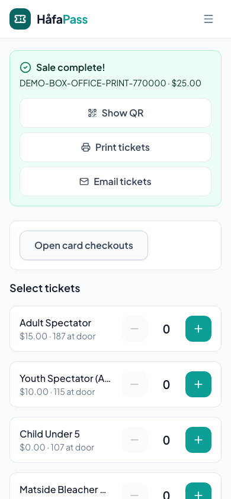  
*Completed cash sale with **Show QR**, **Print tickets**, and **Email tickets**. Demo data · all names fictional.*

  
***Show QR** full-screen view for buyers to photograph at the table. Demo data · all names fictional.*

  
***Email tickets** confirmation after queueing delivery. Demo data · all names fictional.*

---

### Step 2B: Pay by card (only when enabled for Copa)

1. Select the tickets and check the total shown under **Payment method** (it includes the online service fee).
2. Choose how the buyer will pay:
   - **Pay on buyer’s phone** *(default for card sales — buyer scans a QR and pays on their own phone).*
   - **Enter card on this device** *(**Door lead only / last resort** when the buyer cannot pay on their own phone. Never write down a card number or repeat it aloud.)*
3. Tap **Prepare Stripe checkout**. This holds the tickets for **35 minutes**.

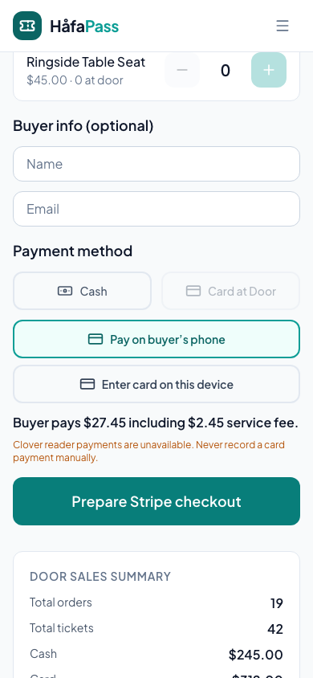  
*Choosing **Pay on buyer’s phone** or **Enter card on this device** (greyed-out **Card at Door** is off). Demo data · all names fictional.*

#### Pay on buyer’s phone (QR)

1. Show the **Scan to pay** QR to the buyer so they can scan it with their phone camera.
2. If you typed their email, you can tap **Email payment link**.
3. Wait for the status to update (or tap **Check payment status**).
4. If the buyer decides not to buy before paying, tap **Cancel sale** so the tickets go back on sale right away.

  
***Pay on buyer’s phone** waiting screen with payment QR. Demo data · all names fictional.*

#### Enter card on this device (Door lead only / last resort)

1. Tap **Open Stripe checkout** to open Stripe's payment page.
2. Enter the card details quietly — **never write down the card number or read it aloud**.
3. Return to the HåfaPass tab and wait for **Paid — tickets ready** before handing over tickets.

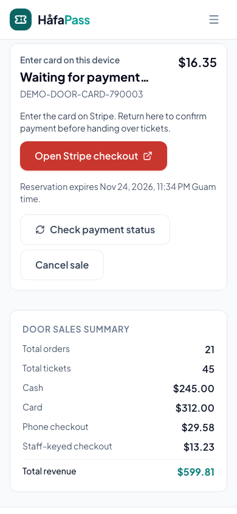  
***Enter card on this device** waiting screen (Door lead only / last resort). Demo data · all names fictional.*

#### Lost tab or buyer stepped aside? Use "Open card checkouts"

1. Tap **Open card checkouts** near the top of Box office.
2. Find the buyer's pending (`Waiting for payment…`) or paid (`Paid — tickets ready`) order.
3. Tap **Show payment QR**, **Open checkout**, or **Show tickets** to reopen that exact sale.
4. **Never ring up a second sale while an open checkout is pending.**

  
***Open card checkouts** recovery list. Demo data · all names fictional.*

#### If you see "Paid — waiting for confirmation"

Stripe received the payment, and HåfaPass is finishing the tickets.

1. **Tell the buyer:** *"Your payment went through; your tickets will appear in a moment."*
2. **STOP — do NOT charge the card again and do NOT ring it up as Cash.**
3. Wait a few seconds and tap **Check payment status** until it says **Paid — tickets ready**.
4. Only hand over tickets once **Paid — tickets ready** shows the QR code(s).
5. If it stays stuck for about 2 minutes *(suggested threshold — confirm with HåfaPass on-call)*, call the **Door lead** or **HåfaPass on-call** with the order reference (`HP-...`).

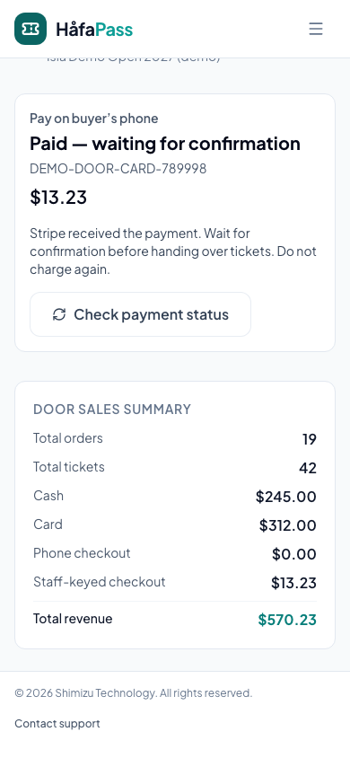  
***Paid — waiting for confirmation** screen. Never double-charge. Demo data · all names fictional.*

#### Paid — tickets ready

1. Show the buyer's ticket QR (use **Previous ticket** / **Next ticket** for multiple tickets).
2. Tap **Email tickets** if an email was entered.
3. Tap **Start next sale** (or **Back to box office**).

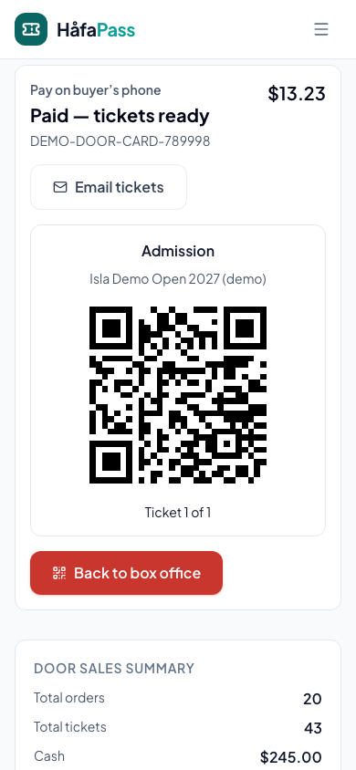  
***Paid — tickets ready** with scannable ticket QR. Demo data · all names fictional.*

#### Checking your totals (Door sales summary)

Scroll to **Door sales summary** at the bottom of Box office to see running totals for **Cash**, **Card** *(reader — should be `$0.00` unless the Door lead says otherwise)*, **Phone checkout**, and **Staff-keyed checkout**.

  
***Door sales summary** by payment method. Demo data · all names fictional.*

---

## Refreshing the Saved Ticket List

Each scanner phone saves a signed copy of the ticket list *(also called the offline manifest)* in its browser so your lane keeps working if gym Wi-Fi or cell signal drops.

### When to refresh

1. **15–30 minutes before doors open** (every scanner phone).
2. **At division breaks** (for example, before afternoon divisions and before finals).
3. **After a burst of walk-up sales, comps, or refunds** so new and cancelled tickets reach every lane.
4. **Right after coming back online** after an outage.

### How to refresh

1. Check that the top-left badge says **Online**.
2. Tap **Sync now**. This uploads any saved offline scans and downloads the newest ticket list.

### How to tell your ticket list is current

- **Ticket list ready · N tickets** shows above the camera, with **`Access expires [date/time] · Pacific/Guam`** in the future.
- **Waiting to sync** is **0**.
- To check the exact version number, scroll down and tap **Device details** → look for **`Saved ticket list · version N · M tickets`**.

### What to do if the network drops (Offline mode)

1. **Keep the scanner open and keep scanning** while the saved ticket list is unexpired.
2. Watch **Waiting to sync** go up — those scans are saved on your phone until it syncs.
3. **Do not** sign out, switch accounts, clear browser history/site data, or tap **Reset trusted device** while **Waiting to sync** is above `0`.
4. **Send confusing duplicates to the Door lead** — other offline phones cannot see your queued scans yet.
5. As soon as **Online** comes back, tap **Sync now** and wait for **Waiting to sync** to reach **0**.
6. If the saved ticket list expires while offline, pause that lane, leave the browser tab open so saved scans are not lost, and switch to the **Backup Attendee List** at the Manager Desk.

---

## Backup Attendee List and Paper Fallback

### Organizer: Export before doors open

Do this **15–30 minutes before doors open** (and again at midday break if needed).

**Data safety rules (required):**
- Export on the **organizer's laptop** — **not** on a personal volunteer phone.
- **No photos, no screenshots, and no sharing the attendee list in group chats.**
- **Delete the CSV file from every device after the event** once final counts are checked.

**Exact steps on the organizer's laptop:**
1. Open **Dashboard → Copa de Marianas**.
2. In the left sidebar under **Attendees**, click **Attendee list**.
3. Click **Export this list**.
4. Keep **Name**, **Order #**, **Ticket type**, **Status**, and **Check-in time** checked. *(Uncheck **Email** and **Phone** before handing any printout to a lane, or keep the full list strictly at the Manager Desk.)*
5. Click **Download CSV** and save it on the Manager Desk laptop.
6. Also click **Print door list** on the same screen (or tap the download icon in **Door totals** on Check-in) for a printable PDF door list.
7. Keep a blank **numbered paper exception log** (`#`, `Time`, `Gate`, `Name`, `Order #`, `Tier`, `Reason`, `Initials`) at the Manager Desk.

  
*Organizer Event Overview showing **Attendee list**, **Door Scanner**, **Box office**, and live **Inside now**. Demo data · all names fictional.*

#### Organizer setup & attendance report (desktop)

- **Set Re-entry policy before doors open:** **Edit event → Settings → Re-entry policy**.
- **Download live or final attendance CSV:** **Reports → Attendance & Door Pace → Download CSV**.

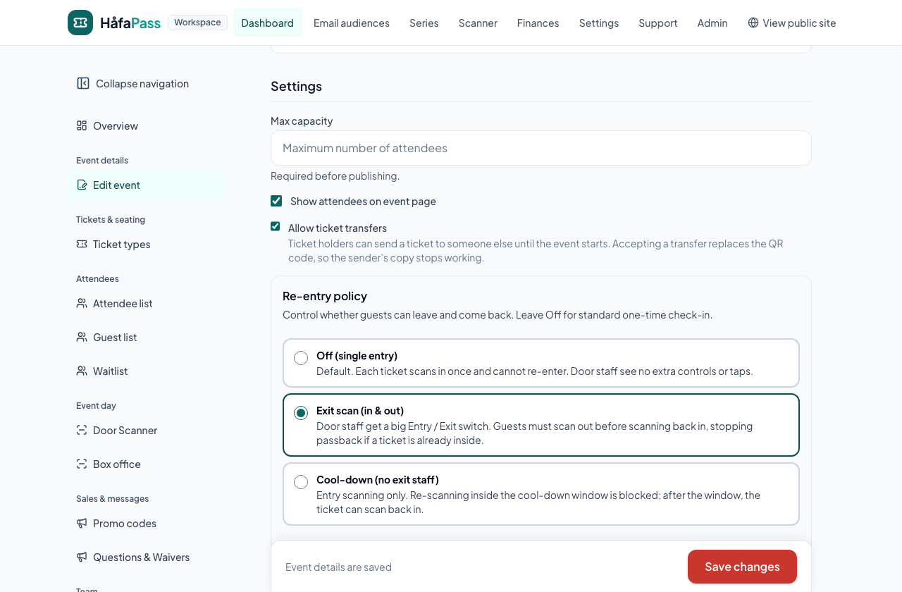  
*Organizer **Re-entry policy** settings. Choose before doors open. Demo data · all names fictional.*

  
*Organizer **Attendance & Door Pace** and **Re-entry & Headcount** report with **Download CSV**. Demo data · all names fictional.*

### Volunteers: Using the backup list if scanners fail

Use the backup list only when the **Door lead** calls it:

1. Search the list by **Name** or **Order #** (`HP-...`).
2. Check the **Status** column:
   - **`Valid`** *(or **`Paid`** if exported in Orders view)* → OK to admit.
   - **`Checked in`**, **`Cancelled`**, **`Refunded`**, **`Partially refunded`**, or **`Transferred`** → **Do not admit**; send the guest to the **Door lead**.
3. Cross off or highlight the row and write the **time, gate, and your initials**.
4. If a guest bought right after export and shows a valid receipt, write them on the **numbered paper exception log** with the Door lead's OK.
5. **Check off paper entries online later:** Once scanners are back online, the Door lead checks in each manually admitted ticket through **Find an attendee** so final counts match. Keep all paper logs until that is done.
6. **Return and delete:** Hand all printed lists back to the Door lead at close, and delete the backup CSV from every laptop/device after final counts are checked.

---

## End-of-Night Checklist

Finish **before** volunteers sign out or leave:

- [ ] **Sync every scanner to zero:** On every door phone, confirm **Online**, tap **Sync now**, and check **Waiting to sync: 0**. Do **not** clear browser data or sign out until it says `0`.
- [ ] **Review conflicts and overrides:** Door lead checks **Flagged offline conflicts** and **Recent admissions** on Check-in, plus **Reports → Attendance & Door Pace**.
- [ ] **Check open card checkouts:** On every box-office device, tap **Open card checkouts** and confirm nothing is stuck in `Waiting for payment…` or `Paid — waiting for confirmation`.
- [ ] **Count cash with two people:** Count physical cash minus the starting float.
- [ ] **Match Box Office totals by method:** Open **Box office → Door sales summary** and write down:
  - **Cash:** `$________` *(must match net counted cash; note any difference)*
  - **Card (reader):** `$________` *(should be **$0** unless the Door lead says otherwise)*
  - **Phone checkout:** `$________`
  - **Staff-keyed checkout:** `$________`
  - **Total revenue:** `$________`
- [ ] **Finish paper entries & destroy/delete lists:** Check off any paper admissions online, collect all printed attendee lists and the exception log, and delete backup CSV files from every device.
- [ ] **Sign out and charge:** After the Door lead gives the all-clear, sign out of shared devices and plug all phones, printers, and battery packs in to charge.

---

## Print-Friendly Role Cards

Print **one double-sided Letter sheet per lane** (open the `.html` card in Chrome or Safari and print double-sided on Letter paper — verified at exactly 2 pages each):

- **Door Scanner Card:** [Print-ready HTML (2 pages Letter)](PRINT_SCANNER_CARD.html) · [Markdown version](PRINT_SCANNER_CARD.md)
- **Box Office Card:** [Print-ready HTML (2 pages Letter)](PRINT_BOX_OFFICE_CARD.html) · [Markdown version](PRINT_BOX_OFFICE_CARD.md)

---

## Screenshot Sources and Deeper Runbooks

*Screens from the Nov 24 builds (PRs #236, #240, #242) — refresh before printing.*

| Image(s) | Screen | Source PR / Branch |
| --- | --- | --- |
| `01`–`05`, `11` | Check-in ready (single-entry), Admitted, Check ticket, Do not admit, Offline mode, Find an attendee | PR #237 (`feat/demo-staff-foundation`) + PR #242 (`feat/re-entry`) |
| `06`–`10` | Exit-scan ENTRY/EXIT switch, Already inside, Exited, Cool-down wait, Cap reached + Lead override | PR #242 (`feat/re-entry`) |
| `12`–`15` | Box office tiers (Adult/Youth/Under-5 free), Cash complete, Show QR, Email tickets | PR #236 (`feat/box-office-print-tickets`, on `main`) + PR #237 |
| `16`–`22` | Payment methods + fee quote, Pay on buyer’s phone QR, Enter card on this device, Open card checkouts, Paid — waiting for confirmation, Paid — tickets ready, Door sales summary | PR #240 (`feat/box-office-card-links`) |
| `23`–`25` | Organizer Event Overview (sidebar + Inside now), Re-entry policy settings, Attendance & Door Pace report | PR #237 + PR #242 (`feat/re-entry`) |

### Deeper Runbooks

- [Event-Day Operations](../EVENT_DAY_OPERATIONS.md) — Scanner safety rules, 3-device offline drill, offline journal recovery, and outage playbook
- [Copa de Marianas 2027 Readiness](../COPA_2027_READINESS.md) — Launch gates, release/rollback, and organizer action items
- [Organizer Onboarding](../ORGANIZER_ONBOARDING.md) — Event setup, spectator tiers, retail cash outlets, and payout schedule
- [Role Matrix](../ROLE_MATRIX.md) — Exact permissions for Owner, Manager, Box office, Scanner lead, and Door scanner
- [FD Alumni Tournament 2027 Operations Runbook](../FD_TOURNEY_2027_OPERATIONS_RUNBOOK.md) — Timed 3-phone physical rehearsal script and Go/No-Go scorecard
