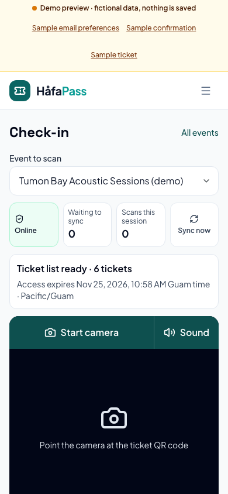
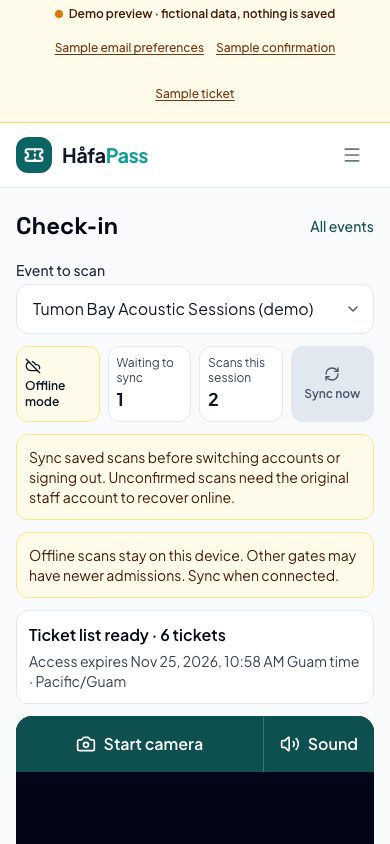
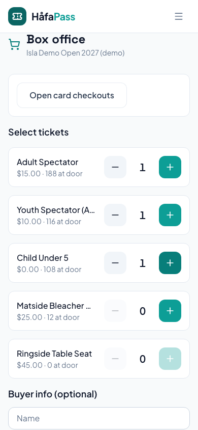
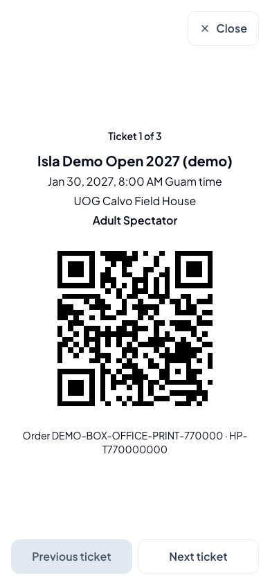
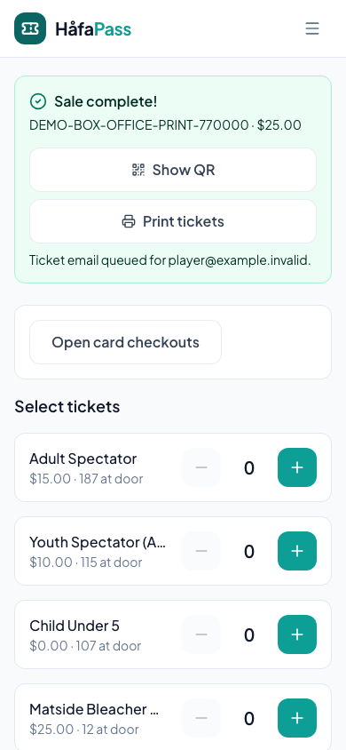
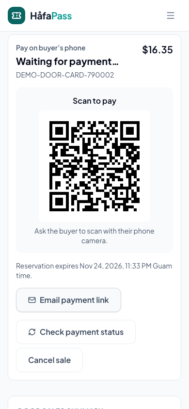
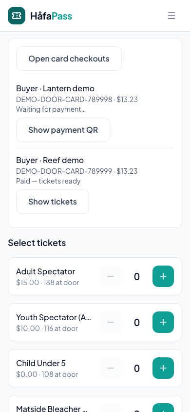
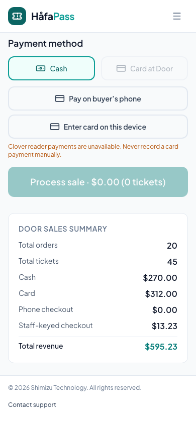
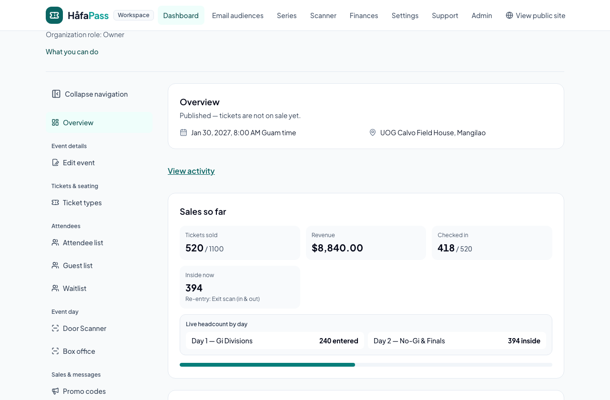
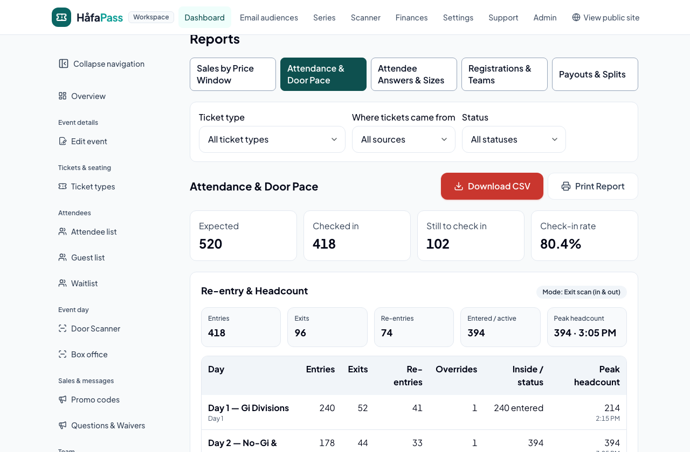

# Copa de Marianas 2027 — Volunteer Door Kit

**Saturday, January 30, 2027 · UOG Calvo Field House (Mangilao)**  
~650+ competitors (registered through ASJJF) · **Spectator tickets:** Child **$12** · Adult **$17** · **Under 5 free** *(confirm exact age cutoff with the organizer before doors open)*

> **Notice:** **Screens from the Nov 24 builds (PRs #236, #240, #242) — refresh before printing.**  
> **Demo data · all names fictional.** Prices, counts, emails, and attendee names shown in screenshots are fictional preview data from *Isla Demo Open 2027 (demo)*.

## Jump to your role

- [Emergency & Escalation Contacts](#escalation-contacts)
- [10-Minute Pre-Doors Checklist](#10-minute-pre-doors-checklist)
- [Role 1: Door Scanner (Phone Guide)](#role-1-door-scanner)
- [Re-entry / Stamp Rule — Choose One Before Event Day](#re-entry-or-hand-stamp-rule-choose-one-before-event-day)
- [Role 2: Box Office (Cash & Card Sales)](#role-2-box-office)
- [Offline Ticket List (Manifest) Refresh](#offline-manifest-refresh)
- [Backup Attendee CSV & Paper Fallback](#backup-attendee-csv-and-paper-fallback)
- [End-of-Night Checklist](#end-of-night-checklist)
- [Print-Friendly One-Sheet Role Cards](#print-friendly-role-cards)
- [Screenshot Sources & Deeper Runbooks](#screenshot-sources-and-deeper-runbooks)

---

## Escalation Contacts

Fill in before doors open. Keep attendee details off public chats.

| Role | Name & Phone | When to call |
| --- | --- | --- |
| **Door lead** | `[Door lead name / phone]` | Duplicate scans, re-entry overrides, refunds/transfers, cash questions, paper fallback |
| **Backup lead** | `[Backup door lead / phone]` | When the Door lead is busy at another gate |
| **HåfaPass on-call** | `[HåfaPass on-call]` | App outage, sync stuck, expired signing key, Stripe card confirmation stuck |
| **Venue contact** | `[Venue contact]` | UOG Calvo Field House doors, power, Wi-Fi, crowd flow, parking |
| **Medical / Security** | `[Medical]` | Any injury, fainting, heat, or safety incident (call 911 first for emergencies) |

---

## 10-Minute Pre-Doors Checklist

Do this together **10–15 minutes before doors open**:

- [ ] **Phone ready:** Charged to 100%, battery pack or cable plugged in, brightness high, volume up (so you hear scan beeps).
- [ ] **Screen stays awake:** Set iPhone **Auto-Lock** or Android **Screen timeout** to **Never** for your shift.
- [ ] **Your own login:** Sign into HåfaPass in Safari (iPhone) or Chrome (Android) with **your own** staff invitation. Never share one phone login between volunteers.
- [ ] **Scanner check:** Open **Scanner**, pick the Copa event, confirm **Online**, **Waiting to sync: 0**, and **Ticket list ready · N tickets** with a future Guam expiry time. Tap **Sync now** once.
- [ ] **Test scan:** Tap **Start camera**, allow camera permission, scan one test QR, and test typing a code under **Enter a ticket QR code**.
- [ ] **Re-entry rule agreed:** Everyone at the door knows whether Copa is using **Exit scan** or **Hand stamp (Re-entry Off)** today.
- [ ] **Box office check:** Confirm starting cash float, small bills for change, and whether **Stripe card sales** (`Pay on buyer’s phone` / `Enter card on this device`) are enabled. Check printer paper/battery if printing tickets.
- [ ] **Backup list at Manager Desk:** Confirm the timestamped **Backup Attendee CSV** and printed **Door List PDF** plus numbered exception log are at the Manager Desk (kept private).

---

## Role 1: Door Scanner

### Step 1: Open, sign in, and pick your gate

1. Open your staff invite link and sign into HåfaPass in Safari or Chrome.
2. Open **Scanner** (`/dashboard/scanner`).
3. Pick **Copa de Marianas** under **Event to scan**.
4. Wait until you see **Online**, **Waiting to sync: 0**, and **Ticket list ready · N tickets**.
5. Tap **Start camera** and allow camera access. Keep **Sound** turned on.

  
*Ready to scan (Off / single-entry mode, PR #237 / #242). Demo data · all names fictional.*

### Step 2: Scan and read the result screen

Point the camera at the guest's QR code (phone screen, screenshot, or printed ticket). The whole screen flashes with the answer:

| Screen color | What it means | What you do |
| --- | --- | --- |
| **Green — Admitted** | Valid ticket. Clears by itself in ~1 second. | Welcome **one person** in. If using hand stamps, stamp them now. |
| **Amber — Check ticket** | Already scanned, already inside, or waiting on cool-down. Stays until tapped. | **Do not wave them in.** Tap to dismiss, read the reason under the camera, and send them to the **Door lead**. |
| **Red — Do not admit** | Wrong event or day, QR not found, cancelled, refunded, or limit reached. Stays until tapped. | **Do not admit.** Tap to dismiss, read the reason, try **Find an attendee**, or send to the **Door lead**. |
| **Blue — Exited** | Guest scanned out in Exit-scan mode. Clears in ~1 second. | Let them step out; they can scan back in later. |

#### Green: Admitted

  
*Valid admission (PR #237 / #242). Demo data · all names fictional.*

#### Amber: Already used (single-entry mode)

  
*Already admitted in Off / single-entry mode (PR #237 / #242). Tap to dismiss and read the ticket details below the camera. Demo data · all names fictional.*

#### Red: Wrong event / day, not found, or cancelled

  
*Not in this event's ticket list, wrong day/event, or revoked ticket (PR #237 / #242). Tap to dismiss and check with **Find an attendee** or the Door lead. Demo data · all names fictional.*

#### Offline mode (bad gym signal)

If Wi-Fi or cell signal drops, keep scanning — the phone checks the signed local list and saves each scan in **Waiting to sync**.

  
*Offline mode after scanning while disconnected (PR #237 / #242). Do **not** sign out or clear browser data; tap **Sync now** once signal returns. Demo data · all names fictional.*

#### Guest has no working QR? Use Find an attendee

1. Tap **Find attendee** (or scroll down to **Find an attendee**).
2. Type the guest's name or ticket number (`HP-T...`) and tap **Search**. *(Email addresses stay hidden for privacy.)*
3. Confirm the name and ticket type, then tap **Admit**.

  
*Online manual attendee lookup (PR #237 / #242). Demo data · all names fictional.*

---

### Step 3: Re-entry scanning (only if Copa turns Re-entry ON)

*(Screens from PR #242 `feat/re-entry`.)*

#### A. Exit scan mode (`ENTRY / EXIT` switch)

When the organizer sets Re-entry to **Exit scan (in & out)**, a large **ENTRY / EXIT** toggle and live **Inside now** headcount appear on your scanner:

1. **Incoming lanes:** Keep the switch on green **ENTRY**.
2. **Outgoing lane:** Tap blue **EXIT** before scanning guests who are stepping out.

  
*Exit-scan mode with **ENTRY / EXIT** switch and live **Inside now** count (PR #242). Demo data · all names fictional.*

- **Already inside (passback stop):** If someone tries to scan in on a ticket that is already inside, the screen flashes amber **Already inside** with the exact time and gate of the first scan. Have them scan out at Exit first, or send them to the **Door lead**.

  
*Anti-passback alert when scanning an already-inside ticket at ENTRY (PR #242). Demo data · all names fictional.*

- **Scanning a guest out:** Switch to **EXIT** and scan their QR. A blue **Exited** flash confirms they are checked out and lowers the **Inside now** count by 1. *(Scanning a ticket that isn't inside shows **Not inside**.)*

  
*Confirmed exit scan (PR #242). Demo data · all names fictional.*

#### B. Cool-down mode (no exit staff)

If the organizer uses **Cool-down (no exit staff)** instead, there is no Exit switch. Re-scanning a ticket inside the wait window shows amber **Wait to re-enter** with the exact minutes left:

  
*Cool-down wait warning (PR #242). Demo data · all names fictional.*

#### C. Re-entry limit reached & Scanner Lead Override

If a ticket hits its max re-entry cap (or cutoff time), the screen shows red **Re-entry limit reached**. Regular scanners send the guest to the **Door lead**.

A **Scanner lead** (or Owner / Manager / Box office) while **online** can tap **Lead override** in the result panel:

1. Tap **Lead override**.
2. Pick **Admit (re-entry)** or **Clear inside status**.
3. Type a short reason (required — saved to the permanent audit log).
4. Tap **Confirm override & Admit** (or **Confirm override & Clear**).

  
*Re-entry cap reached with expanded audited **Scanner lead override** form (PR #242). Demo data · all names fictional.*

---

## Re-entry or Hand-Stamp Rule — CHOOSE ONE BEFORE EVENT DAY

> ### **DECISION REQUIRED BEFORE JAN 30: CHOOSE OPTION A OR OPTION B**
> *Leon and the Copa organizer pick **one** policy before doors open and brief every gate volunteer. Do not mix both.*
>
> | | **Option A — Exit scan in HåfaPass** *(PR #242)* | **Option B — Hand stamp + Re-entry Off** *(standard)* |
> | --- | --- | --- |
> | **Organizer setting** | **Edit event → Re-entry policy → Exit scan (in & out)** *(optional: max re-entries & daily cutoff time)* | **Edit event → Re-entry policy → Off (single entry)** |
> | **Staff needed** | Staffed **Entry** lane(s) + staffed **Exit** scanner at exit door | Staffed **Entry** lane(s) + volunteer checking stamps at marked **Re-entry** lane |
> | **First entry** | Scan QR on **ENTRY** → green **Admitted** → guest enters (no ink stamp needed) | Scan QR → green **Admitted** → volunteer stamps wrist/hand |
> | **Leaving** | Guest scans QR on **EXIT** → blue **Exited** | Guest walks out with their stamp (no scan) |
> | **Coming back** | Guest scans QR on **ENTRY** → green **Re-entered** | Volunteer checks the approved event stamp at the re-entry lane *(do **not** re-scan QR — it stays checked in)* |
> | **Passback protection** | Built-in (**Already inside** blocks shared screenshots) | Visual stamp inspection only |
> | **Live headcount** | Automatic **Inside now** count (`in − out`) on scanner & reports | Clicker/manual tally if needed |
>
> *No exit staff available, but still want digital re-entry without stamps?* **Option C — Cool-down (no exit staff)** blocks rapid passbacks for a set wait window (e.g., 15 minutes) with entry-only scanning.  
> **Warning:** Never switch Re-entry from **Exit scan** to **Off** mid-event — anyone currently outside would be blocked from returning.

---

## Role 2: Box Office

Open **Dashboard → Copa de Marianas → Box office** (`/dashboard/events/:id/box-office`).

### Step 1: Pick ticket tiers (Adult, Child, and Under 5 Free)

Copa spectator tiers:
- **Adult Spectator:** **$17**
- **Child / Youth Spectator:** **$12**
- **Child Under 5:** **$0.00 (Free)** — **always tap `+` to issue a free Under-5 QR ticket** when a child under 5 enters with an adult so arena capacity and door counts stay accurate.

*(Demo screenshots below show fictional preview prices `$15 / $10 / $0`.)*

1. Tap **`+`** / **`−`** beside each ticket type to match the buyer's group.
2. Optional: enter **Buyer name** and **Buyer email** (helpful if emailing tickets or a payment link).

  
*Selecting Adult, Child/Youth, and free `$0.00` Child Under 5 tickets (PR #237 / #236). Demo data · all names fictional.*

---

### Step 2A: Cash sale (Show QR / Print / Email tickets)

*(Screens from PR #236 `feat/box-office-print-tickets`.)*

1. **Collect and count the cash first** — never tap Process sale until cash is in your hand.
2. Make sure **Cash** is selected under **Payment method**.
3. Tap **Process sale · $XX.XX (N tickets)**.
4. When the green **Sale complete!** card appears, deliver the tickets using one of three buttons:
   - **Show QR:** Opens a full-screen QR for each ticket (`Ticket 1 of N`) so the buyer can take a photo on their phone. Tap **Next ticket** for multi-ticket orders.
   - **Print tickets:** Opens the browser print sheet with **one QR admission per page** (each multi-night pass night prints on its own page).
   - **Email tickets:** Enter (or confirm) the buyer's email and tap **Send tickets**.

> **Reloaded the page by mistake?** Reloading Box office in the **same browser tab** restores the last completed cash sale so you can still show, print, or email those tickets.

  
*Completed cash sale with **Show QR**, **Print tickets**, and **Email tickets** (PR #236). Demo data · all names fictional.*

  
***Show QR** full-screen view for buyers to photograph at the table (PR #236). Demo data · all names fictional.*

  
***Email tickets** confirmation after queueing delivery (PR #236). Demo data · all names fictional.*

---

### Step 2B: Card sale with Stripe (Phone QR or Staff-Keyed)

*(Screens from PR #240 `feat/box-office-card-links`. Available only when online door card sales are enabled for the event. Never record a card payment as Cash.)*

1. Select the tickets and check the all-in total shown under **Payment method** (includes applicable online service fee).
2. Choose one of the two Stripe card options:
   - **Pay on buyer’s phone** *(preferred — faster, lower fraud risk, buyer uses Apple Pay / Google Pay / card on their own phone)*.
   - **Enter card on this device** *(use when the buyer doesn't have a phone or signal; staff types card details on Stripe's hosted form)*.
3. Tap **Prepare Stripe checkout**. This holds the tickets for **35 minutes**.

  
*Choosing **Pay on buyer’s phone** or **Enter card on this device** with the all-in fee quote (PR #240). Demo data · all names fictional.*

#### Option 1: Pay on buyer’s phone (QR)

1. Turn your phone/tablet toward the buyer so they can scan **Scan to pay** with their phone camera.
2. If you entered their email, you can also tap **Email payment link**.
3. Wait for the status to update automatically (or tap **Check payment status**).
4. If the buyer changes their mind before paying, tap **Cancel sale** so the held tickets return to inventory right away.

  
***Pay on buyer’s phone** waiting screen with Stripe QR (PR #240). Demo data · all names fictional.*

#### Option 2: Enter card on this device (Staff-keyed)

1. Tap **Open Stripe checkout** to open Stripe's hosted card form.
2. Enter the card details and submit on Stripe.
3. Return to the HåfaPass box-office tab and wait until the screen says **Paid — tickets ready** before handing over tickets.

  
***Enter card on this device** waiting screen (PR #240). Demo data · all names fictional.*

#### Recovering a closed tab or pending checkout: "Open card checkouts"

If the browser closed, someone switched tabs, or a buyer walked aside to finish paying:

1. Tap **Open card checkouts** at the top of Box office.
2. Find the buyer's pending (`Waiting for payment…`) or recently paid (`Paid — tickets ready`) order.
3. Tap **Show payment QR**, **Open checkout**, or **Show tickets** to reopen that exact sale. **Never ring up a duplicate sale while an open checkout is pending.**

  
***Open card checkouts** recovery list (PR #240). Demo data · all names fictional.*

#### If you see "Paid — waiting for confirmation"

Sometimes Stripe confirms the card charge a few seconds before HåfaPass finishes issuing the tickets.

- **STOP — do NOT charge the card again and do NOT ring it up as cash.**
- Wait a few seconds and tap **Check payment status** until it changes to **Paid — tickets ready**.
- Only hand over tickets once **Paid — tickets ready** shows the ticket QR(s). If it stays stuck for more than 2 minutes, call the **Door lead** or **HåfaPass on-call** with the order reference (`HP-...`).

  
***Paid — waiting for confirmation** hold state (PR #240). Never double-charge. Demo data · all names fictional.*

#### Paid — tickets ready

Once confirmed, show the buyer's ticket QR (use **Previous ticket / Next ticket** for multiple tickets), tap **Email tickets** if an email was entered, then tap **Start next sale** (or **Back to box office**).

  
***Paid — tickets ready** with scannable door QR (PR #240). Demo data · all names fictional.*

#### Checking your running totals (Door sales summary)

Scroll to **Door sales summary** at the bottom of Box office to see live totals split by **Cash**, **Card**, **Phone checkout**, and **Staff-keyed checkout** — you will match these numbers at end of night.

  
***Door sales summary** breakdown by payment channel (PR #237 / #240). Demo data · all names fictional.*

---

## Offline Manifest Refresh

Each scanner phone stores a signed, verified ticket list (manifest) in browser storage so gates keep moving if UOG Field House Wi-Fi or cell service drops.

### When to refresh

1. **15–30 minutes before doors open** (mandatory on every phone).
2. **At division breaks** (e.g., before Adult & Masters divisions at ~12:00 PM and before Finals).
3. **After a burst of walk-up sales, comps, or refunds** so newly issued or cancelled tickets reach every gate.
4. **Right after reconnecting** from an offline period.

### How to refresh

1. Check the top-left badge says **Online**.
2. Tap **Sync now**. This uploads any queued offline scans and downloads the latest signed ticket list.

### How to tell the manifest is current

Look at two places on the **Scanner** screen:
- **Ticket list ready · N tickets** card right above the camera, with **`Access expires [date/time] · Pacific/Guam`** in the future.
- **Waiting to sync: 0**.
- Need the version number? Scroll down and expand **Device details** to see **`Saved ticket list · version N · M tickets`**.

### What to do when offline

- **Keep the scanner open and keep scanning** as long as the ticket list is valid and unexpired.
- Watch **Waiting to sync** rise — offline admissions are provisional until synced.
- **Do not** sign out, switch accounts, clear browser history/site data, or tap **Reset trusted device** while **Waiting to sync** is above `0`.
- **Route confusing duplicates to the Door lead** — other offline phones cannot see scans queued on your phone yet.
- As soon as **Online** returns, tap **Sync now** and wait for **Waiting to sync** to hit **0**.
- If the manifest expires or authorization fails while offline, **pause that lane**, keep the browser tab intact so saved scans are preserved, and switch to the **Backup Attendee CSV** at the Manager Desk.

---

## Backup Attendee CSV and Paper Fallback

### Organizer: Export before doors open

Do this **15–30 minutes before doors open** (and optionally refresh at the midday break) from a laptop or phone:

1. Open **Dashboard → Copa de Marianas** (`/dashboard/events/:id`).
2. In the left sidebar under **Attendees**, click **Attendee list** (`/dashboard/events/:id/attendees`).
3. Click **Export this list**:
   - Keep **Name**, **Order #**, **Ticket type**, **Status**, and **Check-in time** checked.
   - *Privacy tip:* Uncheck **Email** and **Phone** on copies handed to door lanes, or keep the full CSV strictly at the Manager Desk.
   - Click **Download CSV** and save an offline copy on the Manager Desk laptop/tablet (and print if desired).
4. Click **Print door list** on the same page (or tap the **download icon** in Scanner → **Door totals**) to download the printable PDF door list.
5. Keep a blank **numbered paper exception log** (columns: `#`, `Time`, `Gate`, `Name`, `Order #`, `Tier`, `Reason`, `Staff initials`) next to the backup list.

  
*Organizer event workspace showing **Attendee list**, **Door Scanner**, **Box office**, and live **Inside now** (PR #237 / #242). Demo data · all names fictional.*

#### Organizer setup & post-event reports (1280 px)

- **Choose Re-entry policy before doors open:** **Edit event → Settings → Re-entry policy** (`/dashboard/events/:id/edit`).
- **Live & final attendance CSV:** **Reports → Attendance & Door Pace → Download CSV** (`/dashboard/events/:id/reports?tab=attendance`).

  
*Organizer **Re-entry policy** setup (PR #242). Choose before doors open. Demo data · all names fictional.*

  
*Organizer **Attendance & Door Pace** and **Re-entry & Headcount** report with **Download CSV** (PR #242). Demo data · all names fictional.*

### Volunteers: How to use the backup CSV if the scanner fails

Only switch to the backup list when the **Door lead** calls it:

1. **Search the CSV** (or printed alphabetical list) by the guest's **Name** or **Order #** (`HP-...`).
2. **Check Status:**
   - `Valid` / `Paid` → OK to admit.
   - `Checked in` → **Stop and ask the Door lead** (already entered, or check approved stamp policy).
   - `Cancelled`, `Refunded`, or `Transferred` → **Do not admit**; send to the Door lead.
3. **Mark the entry manually:** Highlight or cross off the row and write the **time, gate, and your initials**. If the guest isn't on the export (e.g., bought right after export) and shows a valid receipt, log them on the **numbered paper exception log** under the Door lead's approval.
4. **Reconcile afterwards:** Once scanners are back online, the Door lead checks in every manually admitted ticket through **Scanner → Find an attendee** (so final check-in counts match) and reviews any conflicts. Never discard paper logs until reconciliation is finished.
5. **Privacy cleanup:** Return all printed lists and CSV copies to the Door lead at close so attendee data is destroyed/archived under the organizer's retention policy.

---

## End-of-Night Checklist

Complete **before** any volunteer signs out or leaves:

- [ ] **Sync every scanner to zero:** On every door phone, confirm **Online**, tap **Sync now**, and verify **Waiting to sync: 0**. Do **not** clear browser data or sign out until `0` is confirmed.
- [ ] **Review conflicts & overrides:** Door lead checks **Flagged offline conflicts** and **Recent admissions** on Scanner, plus **Reports → Attendance & Door Pace** (Entries, Exits, Re-entries, Overrides, Peak headcount).
- [ ] **Check open card checkouts:** On every box-office device, open **Open card checkouts** and confirm no sales are left hanging in `Waiting for payment…` or `Paid — waiting for confirmation`.
- [ ] **Count cash drawer (two people):** Count physical cash minus starting float.
- [ ] **Match Box Office totals by channel:** Open **Box office → Door sales summary** and record:
  - **Cash:** `$________` *(must match net counted cash; note any variance)*
  - **Card (Clover reader, if used):** `$________`
  - **Phone checkout (Stripe QR):** `$________`
  - **Staff-keyed checkout (Stripe):** `$________`
  - **Total door revenue:** `$________`
- [ ] **Reconcile paper fallback:** Back-enter any paper-list admissions and hand the numbered exception log and printed attendee lists to the Door lead.
- [ ] **Sign out & charge:** Once the Door lead confirms sync and counts are done, sign out of shared tablets (if any), revoke temporary scanner devices if not reused, and plug all phones/printers/battery packs in to charge.

---

## Print-Friendly Role Cards

Print **one double-sided sheet per lane** (put in a clipboard or lanyard sleeve):

- [Scanner Volunteer — 1-Page Printable Card (Front & Back)](PRINT_SCANNER_CARD.md)
- [Box Office Volunteer — 1-Page Printable Card (Front & Back)](PRINT_BOX_OFFICE_CARD.md)

---

## Screenshot Sources and Deeper Runbooks

*Screens from the Nov 24 builds (PRs #236, #240, #242) — refresh before printing.*

| Image(s) | Screen | Source PR / Branch |
| --- | --- | --- |
| `01`–`05`, `11` | Scanner ready (Off mode), Admitted, Check ticket, Do not admit, Offline mode, Find an attendee | PR #237 (`feat/demo-staff-foundation`) + PR #242 (`feat/re-entry`) |
| `06`–`10` | Re-entry ENTRY/EXIT switch, Already inside, Exited, Cool-down wait, Cap reached + Lead override | PR #242 (`feat/re-entry`) |
| `12`–`15` | Box office tiers (Adult/Youth/Under-5 free), Cash complete, Show QR, Email tickets | PR #236 (`feat/box-office-print-tickets`, on `main`) + PR #237 |
| `16`–`22` | Stripe card methods, Phone QR, Staff-keyed, Open card checkouts, Paid — waiting for confirmation, Paid — tickets ready, Door sales summary | PR #240 (`feat/box-office-card-links`) |
| `23`–`25` | Organizer Event Overview (sidebar + Inside now), Re-entry policy settings, Attendance & Re-entry report | PR #237 + PR #242 (`feat/re-entry`) |

### Deeper Runbooks

- [Event-Day Operations](../EVENT_DAY_OPERATIONS.md) — Scanner safety invariants, 3-device offline drill, offline journal recovery, and outage matrix
- [Copa de Marianas 2027 Readiness](../COPA_2027_READINESS.md) — Launch gates, release/rollback, and organizer action items
- [Organizer Onboarding](../ORGANIZER_ONBOARDING.md) — Event setup, spectator tiers, retail cash outlets, and payout schedule
- [Role Matrix](../ROLE_MATRIX.md) — Exact permissions for Owner, Manager, Box office, Scanner lead, and Door scanner
- [FD Alumni Tournament 2027 Operations Runbook](../FD_TOURNEY_2027_OPERATIONS_RUNBOOK.md) — Timed 3-phone physical rehearsal script and printable Go/No-Go scorecard
